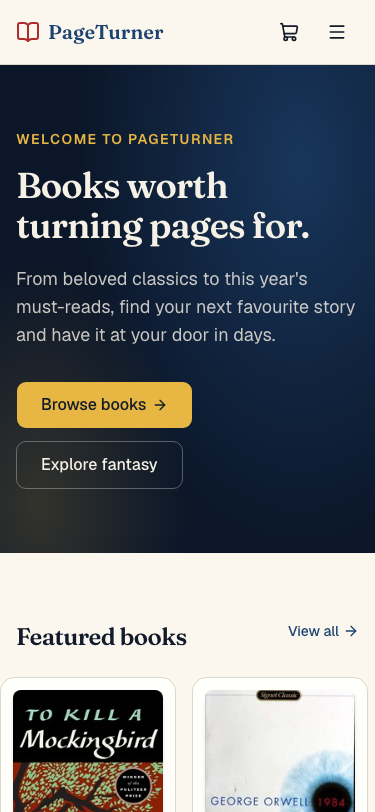
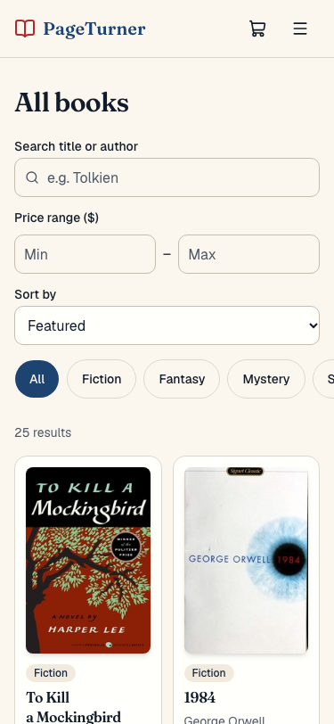
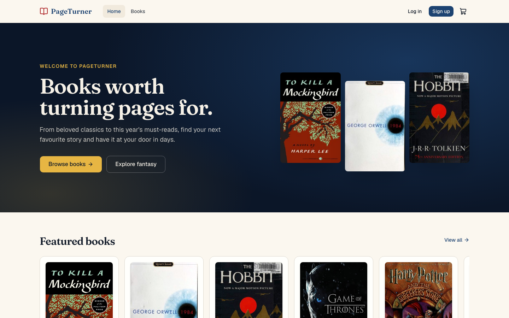
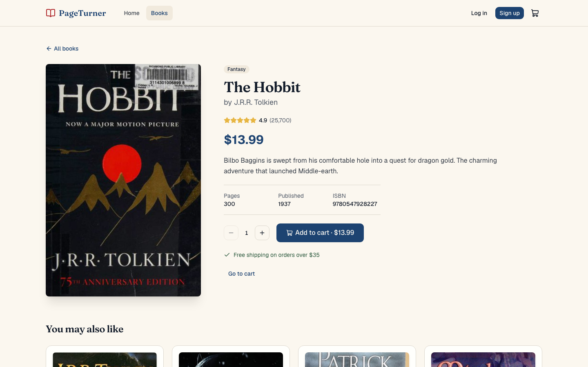

# PageTurner: a responsive eCommerce bookstore


A mobile-first, accessible, front-end-only online bookstore: browse, search, filter, add to cart, and check out (mock). It was designed and built with **IBM Bob**, an agentic coding assistant, for the Applied AI Specialist: Front-end and Mobile capstone.

| Home (mobile) | Books (mobile) | Home (desktop) | Detail (desktop) |
|---|---|---|---|
|  |  |  |  |

## Features

- **Responsive from 320px to 1440px+.** Mobile-first layouts, a slide-in menu, 44px touch targets, and no horizontal overflow at any breakpoint.
- **Catalogue.** 25 books across 5 categories, with cover art from the Open Library CDN and a typographic fallback if a cover fails.
- **Search, filter, and sort.** Title/author search, category pills, price range, and 5 sort orders. State lives in the URL, so views are shareable and back/forward works.
- **Product detail.** Quantity stepper, toast on add, related books, and a friendly not-found state.
- **Cart.** Quantity controls, line totals, shipping (free over $35), tax estimate, and persistence across reloads.
- **Checkout.** Shipping and payment validation (including a Luhn card check), auto-formatted card fields, and focus moved to the first error. Demo only: nothing is processed.
- **Mock auth.** Login and register with inline validation and return-to-previous-page.
- **404, error boundary, and empty states** everywhere they can occur.

## Quality bar

| Check | Result |
|---|---|
| Lighthouse Accessibility / Best Practices / SEO | **100 / 100 / 100** on Home, Books, and Detail |
| Lighthouse Performance (desktop) | **95–99** |
| Lighthouse Performance (mobile, throttled) | **82–93** depending on machine load; CLS **0** on every page |
| axe-core (WCAG 2.1 A/AA + best practices) | 0 violations on 7 routes at 375px and 1440px |
| TypeScript | `strict`, `noUnusedLocals`, `noUnusedParameters`, `verbatimModuleSyntax` |
| Lint (oxlint with `jsx-a11y`) | 0 warnings, 0 errors |
| Scripted E2E + a11y (`npm run test:e2e`) | 22/22 passing: menu, search, cart, checkout, auth, 404s, axe scan |

Accessibility details: skip link, labelled landmarks, `aria-live` result counts, `aria-invalid`/`aria-describedby` on form errors, keyboard-focusable scroll regions, `prefers-reduced-motion` support, per-route document titles, and WCAG AA colour contrast.

Performance details: route-level code splitting, eager/`fetchpriority=high` for above-the-fold covers only, explicit width/height and `aspect-ratio` to prevent layout shift, `preconnect` to the image CDN, self-hosted variable fonts, and memoised context values. The initial JS bundle is about 70 kB gzipped.

## Tech stack

- **React 19** + **Vite 8** + **TypeScript** (strict)
- **Tailwind CSS 4** with design tokens in `src/index.css` (parchment, ink, library blue, gilded gold, sage)
- **shadcn/ui** (Base UI primitives) for `Button`, `Input`, `Sheet`, `Badge`, `Card`, `Skeleton`, `Label`, `Separator`
- **React Router 8**, **Sonner** (toasts), **lucide-react** (icons)
- State: React Context + `useReducer`. There is no backend.

## Getting started

Requires Node.js 22.22 or later (a React Router 8 requirement).

```bash
npm install
npm run dev        # http://127.0.0.1:5173
npm run build      # type-check + production build
npm run preview    # serve the production build
npm run lint       # oxlint (includes jsx-a11y rules)
npm run typecheck  # tsc -b
```

### Verification scripts

Both need Google Chrome installed and the app running.

```bash
npm run dev &              # terminal 1: app on :5173
npm run test:e2e           # user flows + axe accessibility scan (e2e/flows.mjs)

npm run build && npm run preview &   # production build on :4173
npm run perf               # Lighthouse scores for Home, Books, Detail (e2e/lighthouse.mjs)
```

Set `BASE_URL` to point either script at a different host.

## Project structure

```
src/
  components/
    ui/        shadcn primitives
    common/    Layout, Navbar, Footer, FormField, QuantityStepper, ErrorBoundary, LoadingSpinner
    books/     BookCard, BookGrid, BookCover, BookFilters, Rating, BookGridSkeleton
    cart/      CartItemRow, OrderSummary
    checkout/  CheckoutForm
    auth/      LoginForm, RegisterForm, AuthLayout
  context/     CartContext, AuthContext (+ plain context objects in *-context.ts)
  hooks/       useCart, useAuth, useDocumentTitle
  lib/         format, pricing, filterBooks, validation, utils
  data/        books.ts (catalogue)
  pages/       Home, Books, BookDetail, Cart, Checkout, Login, Register, NotFound
  types/       shared types
e2e/           Playwright flows + Lighthouse scripts
```

## Design decisions

- **URL as the source of truth for filters.** Search, category, price, and sort are query params, which gives shareable links and working back/forward for free.
- **Pure logic in `lib/`.** Filtering, pricing, and validation are plain functions that are easy to test, separate from components.
- **Context objects split from providers**, so Fast Refresh keeps working and the hooks (`useCart`, `useAuth`) throw a clear error outside their providers.
- **Cart persistence stores only ids and quantities.** On load, each entry is re-validated against the catalogue, so stale or tampered storage cannot inject data.
- **Security posture.** No secrets, no `dangerouslySetInnerHTML`, dev server bound to `127.0.0.1`, card fields are never stored or logged, and passwords are never persisted. All external requests use HTTPS.

## How Bob was used

Bob planned the work as ten scoped sub-tasks, scaffolded the project, wrote the components, and then **verified its own output**: it ran type-checks, lint, a scripted Playwright browser pass, an axe-core scan, and Lighthouse. Those checks found real issues that Bob then fixed:

- A Suspense fallback that shifted the footer (CLS 0.44 to 0).
- A checkout focus bug.
- Base UI warnings from link-based sheet items.
- A heading-order violation.
- An oversized image `srcset`.

The original plan is kept in [`fe_mobile_capstone-plan.md`](fe_mobile_capstone-plan.md), and the narration for the walkthrough video is in [`VIDEO_SCRIPT.md`](VIDEO_SCRIPT.md).

## Known limitations

- Authentication and payment are simulated. Do not enter real credentials or card numbers.
- Book data is static. Cover images depend on the Open Library CDN and fall back to a text cover if it is unreachable.

## License

MIT, for educational use. Book titles and cover art belong to their respective owners.
